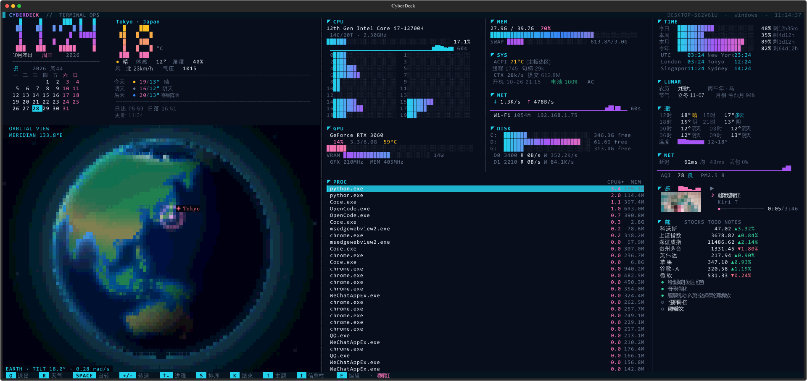
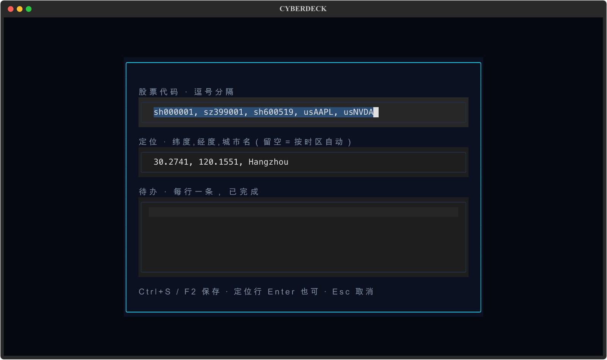

# cyberdeck

终端里的赛博控制台：左边是时钟 / 月历 / 天气 / 旋转地球，右边是 btop 风格的机器监控，
全屏时再多一列「时间 / 农历 / 逐时 / 网络质量 / 自选（行情·音乐·待办）」。



```
┌ CYBERDECK ──────────────────────────────────────────────────────────────────┐
│ 23:41  │ CPU 每核条形 + 波形 │ MEM │ DISK │ 进程表（整宽） │ TIME 进度/世界时钟 │
│ 月历   │ GPU 显存/频率/温度  │ SYS │ NET  │ ↑↓ 选择 · S 排序 · K 结束 │ LUNAR 农历/月相 │
│ 天气   │                     │     │      │                  │ 逐时/NET/AQI/自选  │
│ 地球   │                     │     │      │                  │ 行情/音乐/待办      │
└ Q 退出  R 天气  SPACE 自转  +/- 转速  ↑↓ 进程  S 排序  K 结束  T 主题  I 信息栏 ┘
```

## 运行

```powershell
cd C:\Users\kyle\Desktop\cyberdeck
uv run cyberdeck
```

或直接双击 / 运行 `.\run.ps1`。

固定城市（默认按出口 IP 自动定位）：

```powershell
uv run cyberdeck --city Hangzhou
$env:CYBERDECK_CITY = "Shanghai"; uv run cyberdeck
```

要求：Windows Terminal（或任何真彩色终端），建议窗口 ≥ 110 列 × 30 行（更小会显示提示）。
字体用等宽字体（Cascadia Mono / JetBrains Mono / Consolas）。

## 布局随窗口变化

| 窗口 | 右栏 |
| --- | --- |
| ≥ 210 列 | 硬件两栏 + 进程表，另加最右「信息栏」（可用 `i` 关闭） |
| ≥ 150 列，高度 ≥ 48 行 | 硬件卡片在上，进程表整宽在下 |
| 常规 | 硬件两列（CPU/MEM/DISK/SYS ｜ GPU/NET/PROC） |
| 窄窗口 | 单列，自动保留 CPU/MEM/GPU/进程表 |

## 快捷键

| 键 | 作用 |
| --- | --- |
| `q` / `ctrl+c` | 退出 |
| `r` | 立即刷新天气 |
| `space` | 暂停 / 继续地球自转 |
| `+` / `-` | 加快 / 减慢自转 |
| `t` | 循环切换主题 |
| `1` … `8` | 直接选择主题 |
| `↑` / `↓` | 选择进程 |
| `s` | 进程排序：CPU → 内存 → PID → 名称 |
| `k` 再 `Enter` | 结束选中进程（`Esc` 取消） |
| `i` | 显示 / 隐藏最右信息栏 |
| `e` | 编辑股票代码 / 待办清单 |

主题、城市、信息栏开关都会写进 `config.json`，下次启动自动恢复。

## 终端内编辑（`e`）



一个弹窗同时改两样东西：

- **股票代码**：逗号分隔，`sh` / `sz` / `hk` / `us` 前缀都可以（`sh600519, sz399001, us.AAPL`）
- **待办**：一行一条，`[x]` 表示已完成，`#` 开头是注释

`Ctrl+S` 保存（写回 `config.json` 和 `todo.txt` 并立即刷新），`Esc` 取消。文件本身也可以直接用编辑器改，面板会按修改时间自动重读。

## 地球定位标注

天气数据里带回城市坐标后，地球表面会出现一个**脉动的红色标记**，旁边标着城市名；转到背面时自动隐藏（`MERIDIAN` 读数会同步显示当前正对的经线）。


## 主题

8 套内置主题，同时作用于面板和地球（海洋/陆地/冰盖/大气）：

| # | 名称 | 风格 |
| --- | --- | --- |
| 1 | 赛博霓虹 | 青 + 紫 + 品红 |
| 2 | BTOP 绿 | btop 同款 |
| 3 | 琥珀 CRT | 单色琥珀 |
| 4 | 矩阵绿 | Matrix |
| 5 | Nord | 冷灰蓝 |
| 6 | Gruvbox | 暖复古 |
| 7 | Tokyo Night | 深蓝紫 |
| 8 | Synthwave | 紫 + 品红 |

## 信息栏（自定义区域）

全屏时右侧多出的这一列由 `config.json` 里的 `info` 段控制，改完重启生效：

```json
{
  "theme": "neon",
  "info": {
    "enabled": true,
    "modules": ["stocks", "media", "todo", "notes"],
    "stocks": ["sh000001", "sz399001", "sh600519", "usNVDA", "usAAPL", "usGOOGL", "usMSFT"],
    "zones": ["UTC", "America/New_York", "Europe/London", "Asia/Tokyo", "Asia/Singapore", "Australia/Sydney"],
    "todo_file": null,
    "notes_file": null
  }
}
```

| 模块 | 内容 | 数据源 |
| --- | --- | --- |
| TIME | 今日/本周/本月/今年进度 + 世界时钟 | 本地 |
| LUNAR | 农历、干支、节气、月相 | lunar_python + 本地月相计算 |
| 逐时 | 未来 8 小时温度/天气 + 温度曲线 | wttr.in 缓存 |
| NET | 延迟/抖动/丢包 + AQI/PM2.5 | TCP 握手 + Open-Meteo |
| stocks | 上证/深证/个股（`sh`/`sz`/`us` 前缀） | 腾讯行情 |
| media | 专辑封面 + 律动条 + 标题/歌手/专辑 + 渐变进度条（时间轴外推，1s 刷新） | Windows 媒体会话（winrt）+ Pillow |
| todo | 待办清单 | `todo_file` 或 `%LOCALAPPDATA%\cyberdeck\todo.txt` |
| notes | 自由便签（任意文本，最多 10 行） | `notes_file` 或 `%LOCALAPPDATA%\cyberdeck\notes.txt` |

- `modules` 里删掉某一项即可隐藏该模块；想加行情就把代码写进 `stocks`（如 `us.AAPL`、`hk.HSIC`）。
- 待办文件格式：每行一条，`[ ]` 未完成、`[x]` 已完成，`#` 开头是注释。
- 网络类模块失败只显示 `--`，不会卡界面；`media` 在非 Windows 或缺少 winrt 时自动隐藏内容。

## 性能

屏幕越大越吃资源，所以做了几层控制：

- **地球**：目标 10 fps（单帧 > 13 ms 自动降到 7 fps，暂停后 4 fps 只保留星光闪烁）；颜色量化到 4 bit 并把连续同色像素合并，单帧 span 从 ~3400 降到 ~1800，Text 构建 9 ms → 3 ms；一帧总耗时约 10 ms。
- **采样分层**：CPU/内存 1 s，GPU/进程 4 s，ACPI 温度 60 s，行情 60 s，天气 15 min，AQI 10 min，媒体 10 s，延迟 5 s。
- **按需 IO**：待办/笔记文件按 mtime 读取；配置只在改动时写。
- **窄窗口**：右栏回落单列，只保留必要的区块；窗口小于 110×30 直接只显示提示。

如果还想更省电，把 `globe.py` 里的 `target = 1 / 10` 改成 `1 / 6` 即可。

## 硬件数据来源

| 项目 | 来源 |
| --- | --- |
| CPU 总体/每核、频率、线程/句柄、上下文切换 | psutil |
| 内存 / Swap（页面文件） | psutil |
| GPU 占用、显存、温度、功耗、频率、编解码 | `nvidia-smi` |
| 磁盘分区用量、每块物理盘读写速率 | psutil + `Win32_DiskDrive`（型号） |
| 网卡速率 / IPv4 | psutil `net_if_stats` |
| ACPI 热区温度 | `MSAcpi_ThermalZoneTemperature` |
| 电池 | psutil（剩余时间可用时显示） |

没有装 LibreHardwareMonitor 时读不到 CPU 风扇和逐核温度；装了的话命名空间可被探测（后续可接）。
GPU 风扇/功耗上限在部分笔记本上返回 N/A，会自动隐藏。

## 存储位置

配置与天气缓存依次尝试：`%LOCALAPPDATA%\cyberdeck`、`~/.config/cyberdeck`、`~/.cache/cyberdeck`、
`%TEMP%`、`./.cyberdeck`，取第一个可写目录。

## 结构

```
src/cyberdeck/
  app.py             Textual 应用、布局、键位、主题切换与持久化
  theme.py           8 套调色板、渐变、条形图 / 波形工具
  globe.py           地球引擎（numpy 投影 + 光照）+ 控件
  clock.py           大字时钟 + 月历
  weather.py         wttr.in 客户端 + 天气卡片
  system.py          psutil / nvidia-smi 采样 + 自适应硬件面板 + 进程表
  extras.py          信息栏：时间进度/农历/逐时/延迟/AQI/行情/音乐/待办
  storage.py         配置/缓存路径探测
  bigfont.py         5 行像素数字字体
  data/landmask.npz  预烘陆地掩膜
tools/
  build_landmask.py  重新生成陆地掩膜
  preview_dash.py    把各面板光栅化成 PNG（开发用）
  smoke.py           无头挂载 + 按键冒烟测试
tests/test_core.py   投影、解析、排版、主题、信息栏、进程表单测
```

## 开发

```powershell
uv sync
uv run pytest -q
uv run ruff check src tests tools
uv run python tools/build_landmask.py   # 重新下载海岸线并烘焙掩膜
uv run python tools/smoke.py           # 无头跑一遍，导出 SVG 截图
```

